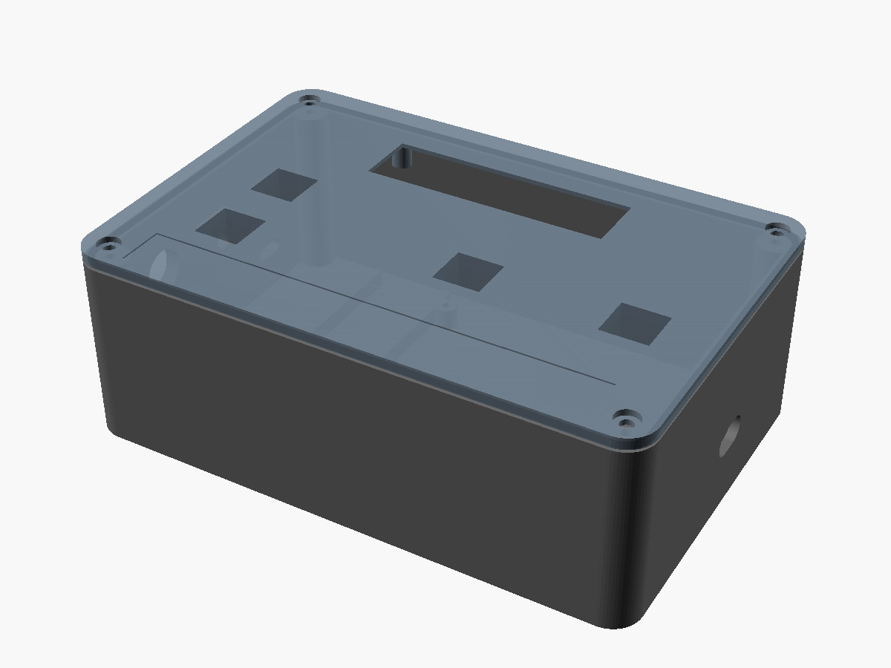
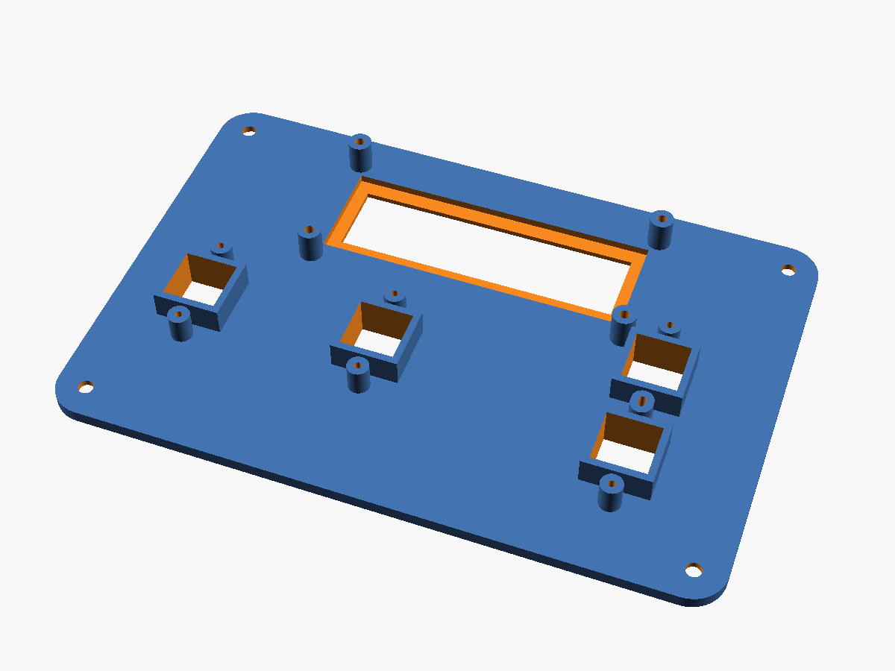
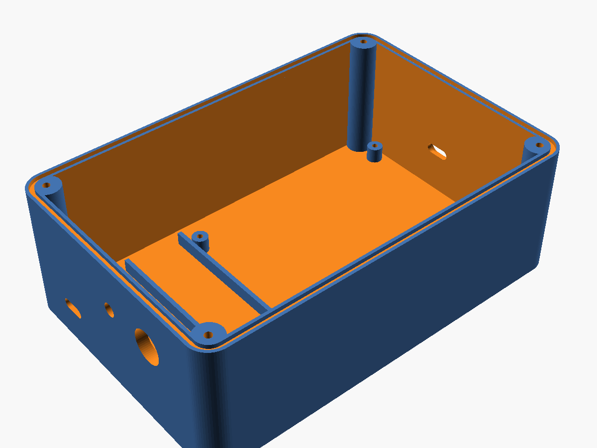

# Printed case

A printable case for the caller, built around the parts already on the breadboard:

- the four Freenove **big push buttons** (12 x 12 mm tactile switches with square colour caps), held in sleeves under the lid so the caps stand 2 mm above it;
- the **GJD 1602IIC** LCD (80 x 36 mm board, I2C chip on the back), on four standoffs behind a clear window;
- the **Freenove ESP32-WROVER** board on a 9 x 7 cm perfboard with header sockets, its USB-C facing the right wall;
- an 18650 cell with a charge-and-boost board, switch, charging port and a recessed BOOT button on the left wall.

The model is `turkey-caller-case.scad` (OpenSCAD, free). Every size is a named value at the top of the file. Values marked `MEASURE` are typical sizes for these parts, not taken from the real ones, so check them before the big prints.

| Closed | Lid from below | Base |
|---|---|---|
|  |  |  |

## Parts to print

| File | Material | Notes |
|---|---|---|
| `fit_test.stl` | PETG | **Print this first** (about 30 min): one lid corner with the yellow button sleeve and one LCD standoff |
| `base.stl` | PETG or ASA | Open side up, no supports |
| `lid.stl` | PETG or ASA | Already flipped top face down, for a smooth face. No supports |
| `clamp.stl` | PETG | Four bars that hold the switches in their sleeves |
| `gasket.stl` | TPU 95A | Optional: 1.5 mm silicone cord or foam tape in the groove works too |

Settings: 0.2 mm layers, 4 walls, 25% gyroid infill, 5 top and bottom layers. Dark grey, black or olive. PLA prints fine for a test but softens in a hot truck, so use PETG or ASA for the real case.

## Before printing: measure and fit test

1. Measure with calipers and change the values at the top of the `.scad` file:
   - `sw_top_h`: from the bottom face of a button's switch body to the top of its cap (default 11.5);
   - `cap` and `sw_body`: the cap and the switch body, both square (default 12);
   - `lcd_holes`: the LCD's hole spacing, centre to centre (default 75 x 31);
   - `lcd_frame_h`: the height of the LCD's metal frame above its board (default 7.5);
   - `perf_holes_inset`: where your perfboard's corner holes are.
2. Print `fit_test.stl`. Push a button into the sleeve from below: the cap should pass the square hole freely and stand about 2 mm proud. Screw the LCD's corner hole to the standoff and check the window sits over the screen.
3. Adjust `fit` (clearance, default 0.4) if the switch is too tight or loose.
4. After the perfboard is built, measure where the ESP32's USB-C sits and set `board_usb_pos` (along the right wall from the inside front corner, and height above the floor). Do the same for the charging board's port (`charge_pos`).

To rebuild the files after a change:

```sh
for p in base lid gasket clamp fit_test; do
  openscad -D "part=\"$p\"" --export-format binstl -o $p.stl turkey-caller-case.scad
done
```

`part="assembly"` shows everything together in the OpenSCAD window.

## Assembly

- **Buttons:** drop each switch into its sleeve from inside the lid, legs pointing left and right (the clamp bar passes between them), then screw a clamp across it with two M2 x 6 self-tapping screws. Solder the wires to the two legs on the **same side** of the switch (the legs facing each other across the switch are always connected, as on the breadboard). Yellow and blue on the left, green in the middle, red alone on the right.
- **LCD:** glue a 72 x 24 x 2 mm clear acrylic plate into the recess under the window with clear silicone. Fix the LCD with four M2.5 x 6 screws. Put its header on the right, away from the yellow button.
- **Perfboard:** four M2.5 x 6 self-tapping screws into the standoffs. The ESP32's USB-C end goes to the right wall and lines up with the port slot. The outside pocket around the slot lets a USB-C plug reach the port through the wall. Fit a silicone USB-C dust plug in the field.
- **Power:** charge board against the left wall, its USB-C at the slot; the 18650 holder between the two rails; toggle switch and recessed BOOT button (a 6 x 6 mm tactile switch glued on the boss behind the 5 mm hole, wired to GPIO 0 and GND) in the left wall.
- **Lid:** gasket in the groove, four M3 x 12 screws (self-tapping, or M3 heat-set inserts with `screw_pilot = 4.0`). A small O-ring or a dab of silicone under each screw head keeps water out of the screw holes.
- **Label:** the 12 mm P-touch tape fits the 0.4 mm recess under the buttons.

## Limits

- The kit's buttons sit in open square holes, so the lid is splash-resistant, not waterproof. Keep the box upright in rain or under a jacket flap. Panel-mount waterproof buttons can replace them later: set `cap` and `sw_body` to the new hole size and remove the sleeves.
- The ESP32-WROVER antenna is the end away from the USB-C, near the middle of the box. Keep the battery and its wires away from it, and check the speaker range once the box is closed.
- The LCD1602 is rated for about 0 to 50 °C, and gets slow and faint below freezing.
